# Music Widget OBS

Виджет для OBS, показывающий текущий трек из браузера.

<p align="center">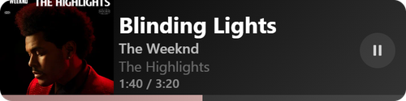</p>

## Как это работает

```
Браузер + Extension  →  WebSocket  →  obs-websocket (OBS, порт 4455)  ⇄  WebSocket  →  OBS Виджет
        ↑                                                ↑
mediaSession + DOM slider              Browser Source → widget.html
```

Расширение каждую секунду опрашивает вкладки браузера, забирает данные из Media Session API и тайминг из DOM, и отправляет их через WebSocket в obs-websocket (встроен в OBS Studio). Виджет подключается к тому же WebSocket-серверу и получает данные в реальном времени.

Расширение поддерживает YouTube, Яндекс.Музыку, Spotify, SoundCloud и другие сайты с Media Session API.

<p align="center">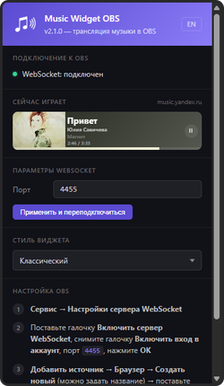</p>

---

## Установка

Скачайте последний релиз и распакуйте в удобное место:  
[music-widget-obs.zip](https://github.com/Stepanchikkk/music-widget-obs/releases/latest/download/music-widget-obs.zip)

### 1. Расширение для браузера

1. Откройте `chrome://extensions/` (Chrome/Edge) или `opera://extensions/` (Opera)
2. Включите **Режим разработчика** — переключатель в правом верхнем углу
3. Нажмите **Загрузить распакованное** (Load unpacked)
4. Выберите папку `extension/` из архива

### 2. WebSocket сервер в OBS

OBS Studio 28+ имеет встроенный WebSocket сервер:

1. В OBS: **Tools** → **WebSocket Server Settings** (или **Сервис** → **Настройки сервера WebSocket**)
2. Включите **Enable WebSocket server** (Включить сервер WebSocket)
3. **Снимите галочку «Enable authentication» (Включить вход в аккаунт)**
4. Порт **4455** (по умолчанию)

Сервер запускается автоматически вместе с OBS.

<p align="center">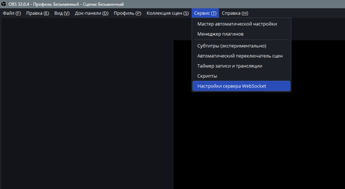 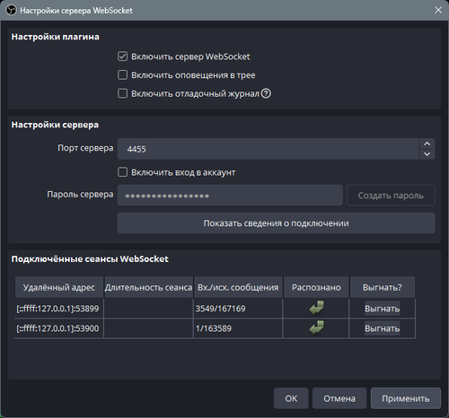</p>

### 3. Виджет в OBS

1. В OBS создайте источник **Browser Source** (или **Браузер**)
2. Выберите **Local File** (Локальный файл)
3. Укажите путь к файлу `widget.html` из архива — или вставьте ссылку `https://stepanchikkk.github.io/music-widget-obs/widget.html`, тогда виджет будет обновляться со временем сам
4. Ширина и высота — на ваш вкус (виджет подстраивается автоматически)
5. Поставьте галочку **Transparent** (Прозрачный фон)

<p align="center">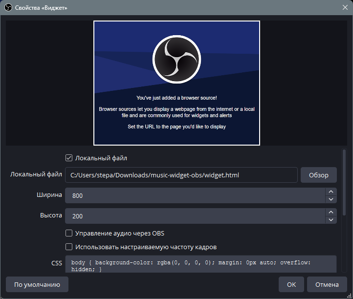</p>

### 4. Текст в OBS (опционально)

Если нужен текст в OBS вместо виджета (или вместе с ним) — используйте нативный **Text (GDI+)**:

1. Sources → **+** → **Text (GDI+)** (в русской OBS — «Текст (GDI+)»)
2. Настройте шрифт, размер, цвет и обводку под свой оверлей
3. Включите **Limit Width** (Ограничить ширину) — от ширины источника зависит прокрутка
4. Снимите галочку **Read from file** (Чтение из файла) — иначе OBS игнорирует текст от расширения
5. В попапе расширения откройте **«Вывод в текстовый источник»**, включите «Вывод», выберите один или несколько источников, задайте формат и разделитель
6. При необходимости включите **«Прокрутку»**, задайте скорость (px/s) и «Отступ» (пробелы в конце строки)
7. Нажмите **«Применить»**

Прокрутку расширение делает нативным фильтром **Scroll** («MW Scroll»): при включении он создаётся на выбранных источниках, при выключении — отключается. «Отступ» добавляет пробелы в конец текста, чтобы на стыке «конец → начало» был зазор.

<p align="center">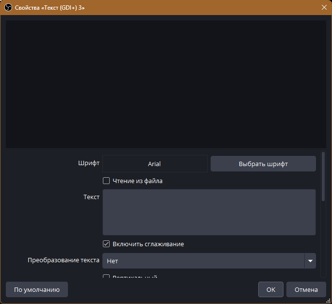</p>

---

## Разные стили на разных сценах

По умолчанию стиль выбирается в попапе расширения и применяется ко всем источникам-виджетам сразу. Если в разных сценах нужны разные стили, стиль закрепляется за конкретным источником — есть два способа.

### Ссылкой со стилем (проще)

В попапе, в секции «Стиль виджета», у каждого стиля есть кнопка копирования — она кладёт в буфер ссылку вида:

```
https://stepanchikkk.github.io/music-widget-obs/widget.html?style=glass-compact
```

Вставьте её в поле **URL** Browser Source (вместо локального файла). Стиль зашит в ссылку, попап на этот источник больше не влияет. Бонус: виджет грузится с сайта и обновляется сам — перекачивать `widget.html` при выходе новой версии не нужно.

Кнопка рядом с базовой ссылкой копирует обычный адрес — это возвращает источник к управлению стилем из попапа.

### Custom CSS (если источник открывает локальный файл)

1. В OBS выберите источник-виджет → свойства → **Custom CSS**.
2. Добавьте строку с нужным стилем:

```css
:root { --widget-style: 'glass-compact'; }
```

Приоритет: Custom CSS важнее ссылки `?style=` и важнее настроек попапа.

Доступные стили: `classic`, `compact`, `glass`, `glass-compact`, `minimal`, `stereo`, `fallout`, `vinyl`, `cover`, `blur`, `player`, `karaoke`.

## Настройка виджета

### Ориентация

Автоопределение по размеру Browser Source в OBS:

| Условие | Раскладка |
|---------|-----------|
| **Ширина ≥ высота** | Горизонтальная (обложка слева, текст справа) |
| **Высота > ширина** | Вертикальная (обложка сверху, текст снизу) |

Меняйте ориентацию, просто изменяя размеры Browser Source в OBS.

<p align="center">
  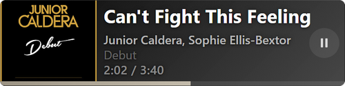<br>
  <em>Горизонтальная 800×200</em>
</p>

<p align="center">
  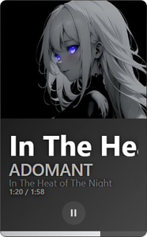<br>
  <em>Вертикальная 280×450</em>
</p>


### Адаптивные цвета

Виджет берёт доминирующие цвета из обложки трека:
- **Фон** — градиент из тёмных тонов обложки
- **Прогресс-бар и акценты** — из светлых тонов

Если обложки нет — фиолетово-голубой дефолт.

### Стили оформления

Виджет поддерживает 12 стилей: `classic` (классический), `compact` (компактный), `glass` (стеклянный), `glass-compact` (компактный стеклянный), `minimal` (минималистичный), `stereo` (магнитола), `fallout` (PIP-Boy), `vinyl` (винил), `cover` (обложка), `blur` (размытие), `player` (плеер), `karaoke` (заголовок).

Если у трека нет обложки, вместо неё подставляется заглушка — стили с обложкой не выглядят пустыми.

<p align="center">
  <br>
  <strong>Классический (<code>classic</code>)</strong>
</p>

<p align="center">
  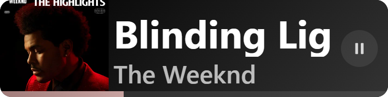<br>
  <strong>Компактный (<code>compact</code>)</strong>
</p>

<p align="center">
  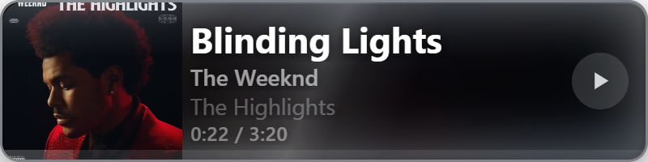<br>
  <strong>Стеклянный (<code>glass</code>)</strong>
</p>

<p align="center">
  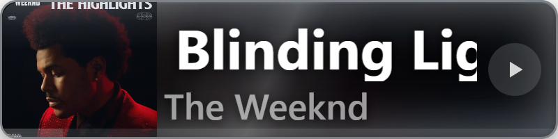<br>
  <strong>Компактный стеклянный (<code>glass-compact</code>)</strong>
</p>

<p align="center">
  <br>
  <strong>Минималистичный (<code>minimal</code>)</strong>
</p>

<p align="center">
  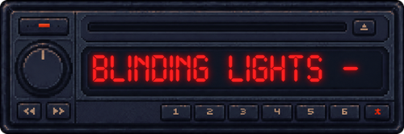<br>
  <strong>Магнитола (<code>stereo</code>)</strong>
</p>

<p align="center">
  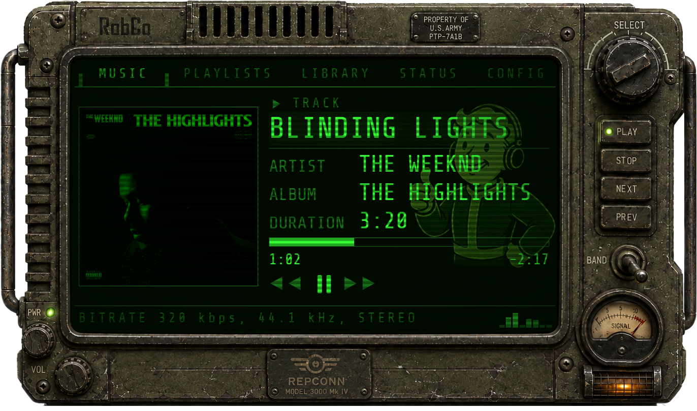<br>
  <strong>PIP-Boy (<code>fallout</code>)</strong>
</p>

<p align="center">
  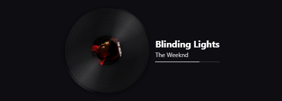<br>
  <strong>Винил (<code>vinyl</code>)</strong>
</p>

<p align="center">
  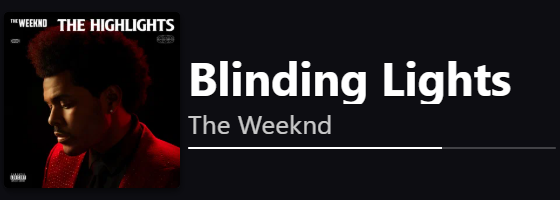<br>
  <strong>Обложка (<code>cover</code>)</strong>
</p>

<p align="center">
  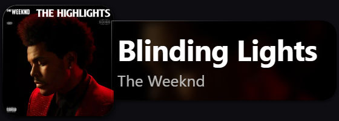<br>
  <strong>Размытие (<code>blur</code>)</strong>
</p>

<p align="center">
  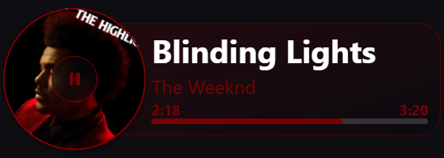<br>
  <strong>Плеер (<code>player</code>)</strong>
</p>

<p align="center">
  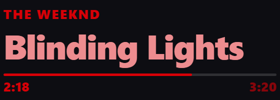<br>
  <strong>Заголовок (<code>karaoke</code>)</strong>
</p>

Стиль переключается в попапе расширения. Чтобы закрепить стиль за отдельным источником — например, когда в разных сценах нужны разные стили — скопируйте в попапе ссылку со стилем (`?style=…`) или задайте `--widget-style` в Custom CSS источника. Подробности — в разделе [«Разные стили на разных сценах»](#разные-стили-на-разных-сценах).

<p align="center">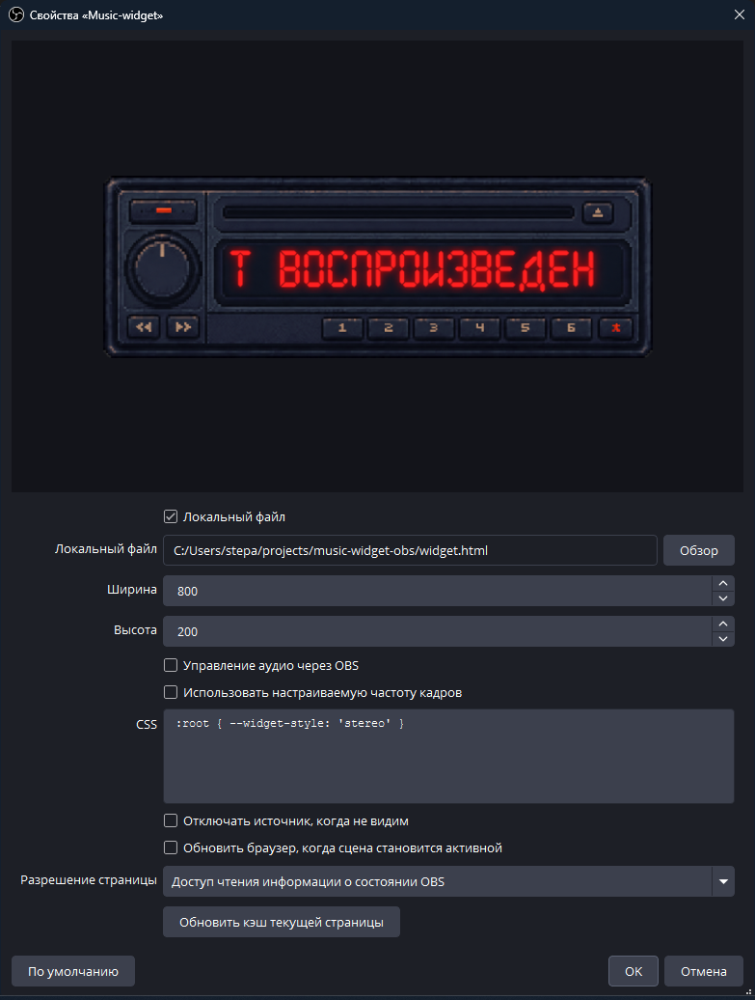</p>

---

## Режим разработки

Для тестирования без OBS откройте `widget.html?mock=1` в браузере — покажет демо-данные.

Параметры URL для виджета:
- `?mock=1` — демо-режим
- `?style=vinyl` — зафиксировать стиль (см. «Разные стили на разных сценах»)
- `?port=xxxx` — нестандартный порт WebSocket
- `?lang=en` — английский язык заглушки

---

## Частые проблемы

| Проблема | Решение |
|----------|---------|
| Виджет пустой / показывает «Нет воспроизведения» | Проверьте, что в OBS включён WebSocket сервер и снята галочка «Включить вход в аккаунт» |
| Расширение не видит музыку | Перезагрузите расширение в `chrome://extensions/`, обновите вкладки с музыкой и нажмите «Обновить» на виджете в OBS |
